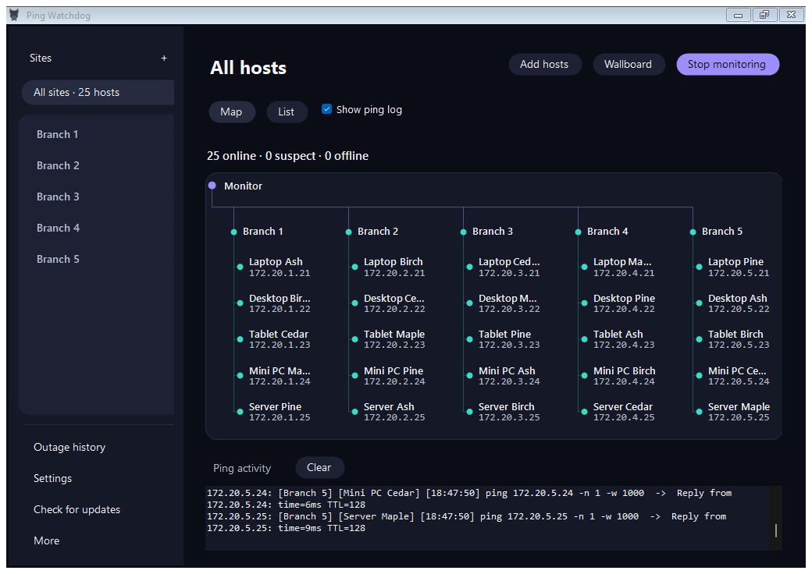
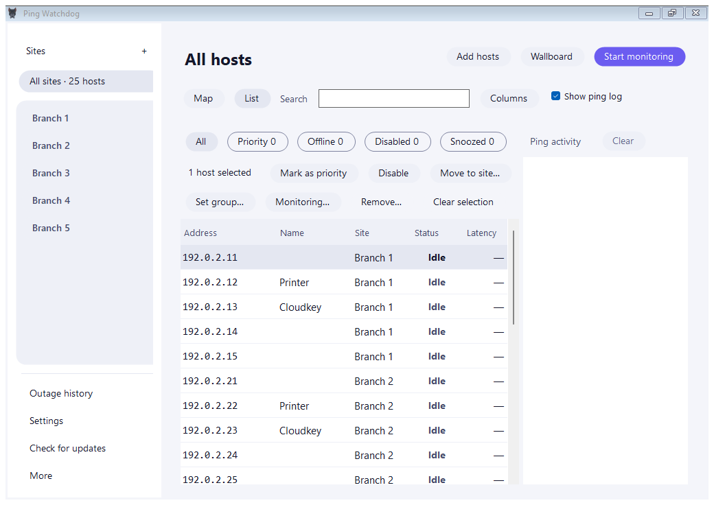

# Ping Watchdog

Ping Watchdog monitors IP addresses and hostnames with ICMP ping. Group devices by site, watch missed replies become outages, and see when a host recovers. A device that blocks ICMP can appear offline even while its services are running.

## Download

[Ping Watchdog website](https://jpluker.github.io/Ping-Watchdog/)

For Windows x64, run the [installer](https://github.com/JPLuker/Ping-Watchdog/releases/latest/download/PingWatchdog-win-Setup.exe) or extract the [portable ZIP](https://github.com/JPLuker/Ping-Watchdog/releases/latest/download/PingWatchdog-win-Portable.zip) and open `PingWatchdog.exe`. Both include the .NET runtime. The Windows builds are unsigned. To verify a download, compare its PowerShell `Get-FileHash` result with the matching filename in the release's [SHA256SUMS.txt](https://github.com/JPLuker/Ping-Watchdog/releases/latest/download/SHA256SUMS.txt).

Linux has a separate beta and installation guide. [Linux beta](README-LINUX.md)

## Run your first monitor

1. Choose **Add hosts → Save hosts to a site…**. Enter a hostname or IP address you expect to answer ping, or paste several addresses on separate lines.
2. Under **Site**, select an existing site or type a new name. Review the preview, check the hosts you want, then click **Add hosts** to save them.
3. Click **Start monitoring**. Select a site in the sidebar to narrow the view, or choose **All sites** for the whole inventory. Enable **Show ping log** to see individual attempts.
4. For a temporary check, choose **Add hosts → Monitor temporarily…**, enter the targets, and click **Start quick monitor**. To save temporary hosts, select them in **List** and choose **Keep in a site**.

The default interval is two seconds with a one-second timeout. Three consecutive failures declare an outage and two consecutive replies declare recovery. A suspect host has missed a reply but has not reached its outage threshold. To change these defaults, stop monitoring and open **Settings → Monitoring**.

## Find and manage hosts

**Map** shows how hosts are grouped by site. Open **Wallboard** for a fullscreen view. Press **Esc** or **F11** to return. The map and Wallboard support host actions through the host's context menu.

**List** lets you search, filter and edit hosts. Select a row and use **Host actions** for its quick actions. From Map or Wallboard, right-click a host and choose **Edit in host list** to open that host directly. Select one or more rows to move hosts, change their group, mark them as priority, or disable them. Press **F2** to rename a selected host. List edits save immediately and offer an eight-second Undo with **Ctrl+Z**. In Settings, use **Save changes** to apply a draft.

| When you need to | What to do |
| --- | --- |
| Silence one host for an hour | Right-click the host and choose **Snooze host for 1 hour**. Probes, live ping output and active outage alerts pause until expiry. Choose **Resume monitoring now** to end the snooze early. Past events stay in history. |
| Keep an alarm sounding until someone responds | Mark the host as priority. Outage and recovery alarms repeat every 15 seconds until acknowledged. Choose the sound in **Settings → Notifications**. |
| Check when an outage started or ended | Open **Outage history** or press **Ctrl+H**. Filter by site or time range, hide suspect events, or export the results to CSV. |
| Share ongoing monitoring with someone on Windows | Choose **More → Export monitoring batch…** to create a batch file they can run without installing Ping Watchdog. |

## Backups and portable storage

To carry a saved configuration to another PC, use the configuration export under **More**. For a complete backup, save any Settings changes, then choose **Settings → Data and storage → Create backup…**. A complete backup includes saved hosts, preferences, snooze deadlines and outage history. It contains unencrypted network inventory, so choose where you keep it.

To restore, stop monitoring, close other copies, then choose **Restore backup…**. Check the site and host counts before confirming. Restore replaces the active data and restarts the app. [Backup and restore guide](DATA-RECOVERY.md)

The portable ZIP uses per-user storage by default. Choose **Enable portable storage…** in the portable copy to move future saves into its package folder. The original per-user files are retained. [Portable storage guide](PORTABLE-AND-DELETION.md)

## Privacy and network connections

Ping Watchdog for Windows stores saved hosts, labels, preferences, snooze deadlines and outage history on the PC. Startup failures can leave local reports with exception details and file paths. Find the active folder under **Settings → Data and storage**. Complete backups include inventory and history in unencrypted JSON. Windows notifications can show host details on the desktop.

| Destination | When a connection happens | What the destination receives |
| --- | --- | --- |
| Configured IP addresses and hostnames | While monitoring, including automatic startup if enabled, or when running a command-window ping or exported batch | ICMP echo requests and the source address visible to the target |
| Your configured name-resolution service | When Windows resolves a hostname and needs a network lookup | The hostname being resolved |
| GitHub release services, including api.github.com, github.com and redirected asset hosts | Automatic or manual update checks and package downloads, including a manually requested check from startup recovery | Requests for this repository's releases, update feed or package, ordinary connection metadata and the requesting IP address |
| GitHub in your browser | When you choose Report an issue or Open downloads | The page request and normal browser metadata. Anything you submit to GitHub is your choice. |

The app requires no account and has no application analytics or automatic crash-report upload. About lets you review diagnostic text before copying it. Review paths and usernames before posting that text. Microsoft's Windows App SDK terms separately describe possible SDK diagnostics. [Microsoft terms](docs/licenses/WindowsAppSDK-2.4.0.txt)

Turn off automatic checks in **Settings → Updates**. To remove active saved data, stop monitoring and use **Settings → Data and storage**. External exports and inactive storage copies must be removed separately. [Deletion scope](PORTABLE-AND-DELETION.md)

## Updates and support

Use **Check for updates** in the sidebar or **Settings → Updates**. When automatic checks are enabled, Ping Watchdog checks at most once a day and downloads available updates in the background. Choose **Restart now** to apply a downloaded update, or **Later** to keep working. A failed restart offers **Retry restart**. An organization policy can disable update checks.

For a problem report, include the version from **Settings → About**, your Windows version and the steps that reproduce it. You can review diagnostic information in About before copying it. [Report an issue](https://github.com/JPLuker/Ping-Watchdog/issues) · [Changelog](CHANGELOG.md)

For support, maintenance scope and private security reporting, see the project policies. [Support](SUPPORT.md) · [Security](SECURITY.md) · [Third-party notices](THIRD-PARTY-NOTICES.md)

## Build and test

On Windows with the .NET 8 SDK, run `dotnet run --project PingWatchdog.csproj -c Release`. Pass `-- --self-test`, `-- --ui-smoke-test`, or `-- --recovery-smoke-test` to run the corresponding checks.

Copyright © 2026 Joseph Luker. Official compiled releases are licensed for personal or internal business use. [License](LICENSE)
